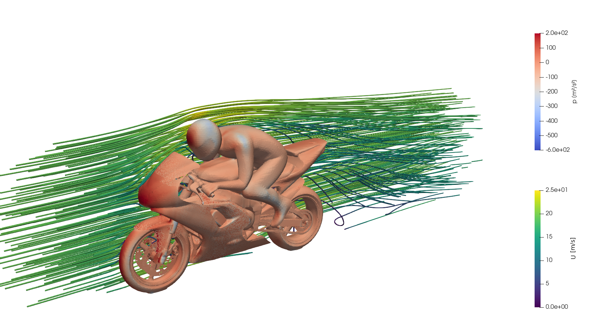
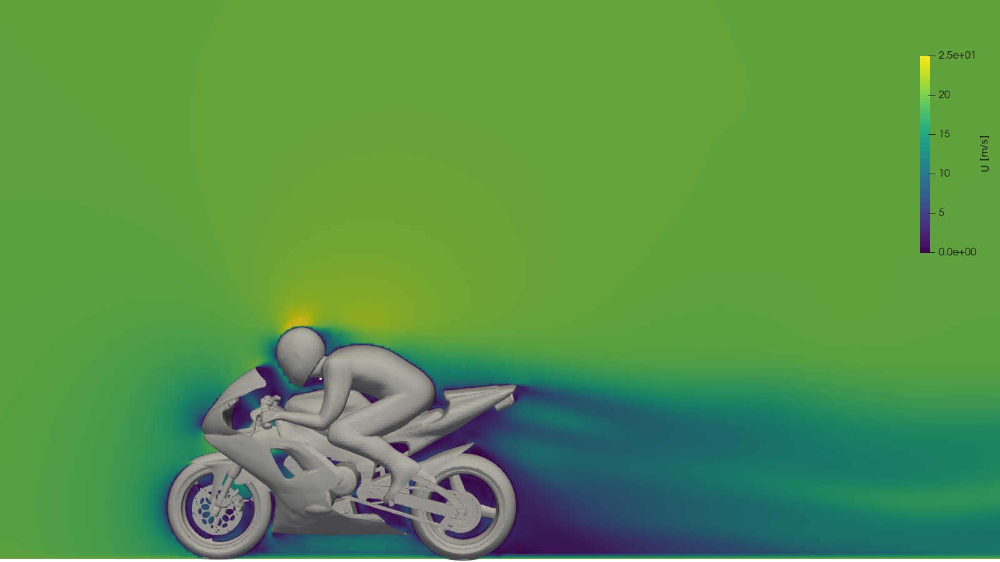
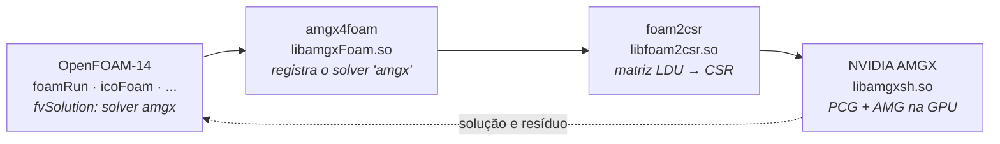

<h1 align="center">openFoam-14-cuda</h1>

<p align="center">
  <b>OpenFOAM-14 (OpenFOAM Foundation) com o solver de pressão na GPU via NVIDIA AMGX</b><br>
  sem alterar uma linha do código-fonte do Foundation
</p>

<p align="center">
  
  
  
  
  
  
</p>

<p align="center">
  
  
  <br>
  <sub>motorBike do tutorial do OpenFOAM-14 (3,2 M células, 500 iterações SIMPLE), o caso usado nos benchmarks de GPU: pressão na superfície com tubos de corrente (esq.) e esteira no plano de simetria (dir.). ParaView.</sub>
</p>

> **Fork comunitário, não oficial.** Não é afiliado nem endossado pela OpenFOAM Foundation
> ou pela ESI/OpenCFD. OpenFOAM® é marca registrada da OpenFOAM Foundation.

## Sumário

- [O que este fork faz](#o-que-este-fork-faz)
- [Estado e resultados](#estado-e-resultados)
- [1. Pré-requisitos](#1-pré-requisitos)
- [2. Baixar](#2-baixar)
- [3. Compilar o OpenFOAM-14](#3-compilar-o-openfoam-14)
- [4. Compilar a parte GPU](#4-compilar-a-parte-gpu)
- [5. Usar a GPU num caso](#5-usar-a-gpu-num-caso)
- [6. Validar antes de confiar](#6-validar-antes-de-confiar)
- [Quando a GPU compensa](#quando-a-gpu-compensa)
- [Solução de problemas](#solução-de-problemas)
- [O que foi corrigido nos projetos de terceiros](#o-que-foi-corrigido-nos-projetos-de-terceiros)
- [Estrutura do repositório](#estrutura-do-repositório)
- [Roteiro](#roteiro) · [Créditos e licença](#créditos-e-licença)

## O que este fork faz

O OpenFOAM monta as equações na CPU. Este fork acrescenta um **solver linear** chamado
`amgx` que envia a matriz da equação de pressão para a GPU, resolve com o multigrid
algébrico da NVIDIA (AMGX) e devolve a solução. Para o OpenFOAM, é só mais uma opção
no `fvSolution`, como `GAMG` ou `PCG`.



| Camada | Papel | Origem |
|---|---|---|
| [AMGX](https://github.com/NVIDIA/AMGX) | multigrid algébrico em CUDA | NVIDIA, usado sem alterações |
| [foam2csr](https://github.com/mattmartineau/foam2csr) | converte a matriz LDU do OpenFOAM para CSR e fala com a AMGX | NVIDIA (M. Martineau), com patch |
| [amgx4foam](https://github.com/maorz1998/amgx4foam) | registra `amgx` como `lduMatrix::solver` | comunidade, **portado para a API do OpenFOAM-14** |

Também compila o OpenFOAM-14 com **Intel oneAPI** (`icx`/`icpx`), usando as regras
que já vêm no Foundation.

## Estado e resultados

| Item | Resultado |
|---|---|
| OpenFOAM-14 com GCC 11.4 | ✅ ~145 solvers e utilitários |
| OpenFOAM-14 com Intel oneAPI 2026.1 | ✅ pressão final **idêntica bit a bit** ao build GCC (cavity) |
| Solver `amgx` na GPU | ✅ cavity e motorBike convergem e batem com a CPU |
| Desempenho, cavity3D transiente (PISO) | ✅ GPU **1,38×** mais rápida com 1 M células e **2,27×** com 3,4 M ([detalhes](cuda/benchmarks/cavity3D.md)) |
| Desempenho, motorBike 3,2 M células | ⚖️ GPU **empata** com a CPU (2,48 × 2,55 s/iteração) em regime permanente |

**motorBike, 3.215.800 células, 4 processos MPI, média das iterações 10–100:**

| Configuração | s / iteração | Iterações do solver de p | Cd (it. 100) |
|---|---:|---:|---:|
| CPU, GAMG (`relTol 0.1`) | 2,550 | 2,0 | 0,7210 |
| GPU, AMGX `tolerance 0.1` | 2,522 | 1,4 | 0,7214 |
| GPU, AMGX `tolerance 0.1` + reaproveitamento do AMG | **2,478** | 1,4 | 0,7200 |

Por que só empata, e onde a GPU deve ganhar: ver [Quando a GPU compensa](#quando-a-gpu-compensa)
e [`cuda/benchmarks/motorBike.md`](cuda/benchmarks/motorBike.md).

**Ambiente testado:** RTX 4050 Laptop (6 GB, compute capability 8.9) · Windows 11 + WSL2 ·
Ubuntu 22.04 · CUDA 13.2 · driver 596.08 · GCC 11.4 · Intel oneAPI 2026.1 · OpenMPI 4.1.

---

## 1. Pré-requisitos

### Hardware

| Requisito | Mínimo | Observação |
|---|---|---|
| GPU NVIDIA | compute capability **≥ 7.0** (Volta ou mais nova) | `nvidia-smi --query-gpu=name,compute_cap --format=csv` |
| Memória da GPU | 4 GB | o motorBike (3,2 M células) usou ~2,6 GB |
| RAM | 16 GB recomendados | a compilação do OpenFOAM usa vários GB |
| Disco | ~25 GB livres | OpenFOAM, AMGX e casos |

### Sistema operacional

- **Ubuntu 22.04**, nativo ou no **WSL2** (Windows 11).
- No WSL2 o driver NVIDIA é o do **Windows**. Não instale driver dentro do Ubuntu.
- No WSL2, deixe pelo menos metade da RAM para o Windows em `%USERPROFILE%\.wslconfig`
  e aplique com `wsl --shutdown`:

  ```ini
  [wsl2]
  memory=8GB
  swap=4GB
  ```

### Pacotes do Ubuntu

```bash
sudo apt-get update
sudo apt-get install -y build-essential flex bison cmake git \
    zlib1g-dev libboost-system-dev libboost-thread-dev \
    libopenmpi-dev openmpi-bin libreadline-dev libncurses-dev libxt-dev rpm \
    libscotch-dev libptscotch-dev \
    libpetsc-real-dev libtrilinos-zoltan-dev
```

`libpetsc-real-dev` e `libtrilinos-zoltan-dev` entram só como dependência de compilação
(da parte GPU e da decomposição Zoltan). Nenhum solver do PETSc é usado.

### CUDA Toolkit (testado com 13.2)

A AMGX e o foam2csr exigem C++17, disponível desde o CUDA 11. Só o CUDA 13.2 foi testado;
o `env.sh` também encontra o CUB no local usado por versões anteriores.

**WSL2**: use o repositório `wsl-ubuntu`. O pacote genérico tenta instalar um driver
Linux, que conflita com o driver do Windows.

```bash
wget https://developer.download.nvidia.com/compute/cuda/repos/wsl-ubuntu/x86_64/cuda-keyring_1.1-1_all.deb
sudo dpkg -i cuda-keyring_1.1-1_all.deb
sudo apt-get update
sudo apt-get install -y cuda-toolkit-13-2
```

**Ubuntu nativo**: igual, trocando `wsl-ubuntu` por `ubuntu2204` na URL.

```bash
export PATH=/usr/local/cuda/bin:$PATH
nvcc --version     # release 13.2 (ou a versão instalada)
which nvcc         # /usr/local/cuda/bin/nvcc
```

> ⚠️ Se `which nvcc` mostrar `/usr/bin/nvcc`, o pacote antigo `nvidia-cuda-toolkit` (CUDA 11.5)
> está instalado e na frente do PATH. Ele não reconhece GPUs recentes e quebra o build.

### Intel oneAPI (opcional)

Só para compilar o OpenFOAM com Intel. A parte GPU usa GCC.

```bash
wget -O- https://apt.repos.intel.com/intel-gpg-keys/GPG-PUB-KEY-INTEL-SW-PRODUCTS.PUB \
  | gpg --dearmor | sudo tee /usr/share/keyrings/oneapi-archive-keyring.gpg > /dev/null
echo "deb [signed-by=/usr/share/keyrings/oneapi-archive-keyring.gpg] https://apt.repos.intel.com/oneapi all main" \
  | sudo tee /etc/apt/sources.list.d/oneAPI.list
sudo apt-get update
sudo apt-get install -y intel-oneapi-compiler-dpcpp-cpp intel-oneapi-compiler-fortran
```

---

## 2. Baixar

O diretório **precisa** se chamar `OpenFOAM-14`: o `etc/bashrc` monta os caminhos a partir desse nome.

```bash
mkdir -p ~/dev && cd ~/dev
git clone https://github.com/ileaof/openFoam-14-cuda.git OpenFOAM-14
cd OpenFOAM-14
```

## 3. Compilar o OpenFOAM-14

### GCC (padrão)

```bash
cd ~/dev/OpenFOAM-14
source etc/bashrc
./Allwmake -j 4 > log.Allwmake 2>&1      # 1 a 2 horas, conforme a máquina
ls $FOAM_APPBIN | wc -l                  # ~145
```

- Use `-j` com no máximo metade dos núcleos: cada processo de compilação usa 1 a 2 GB de RAM.
- Erros em `PVReaders` (leitores do ParaView) são esperados sem o ParaView instalado no Ubuntu e não afetam os solvers.

### Intel oneAPI (opcional)

As regras para `icx` já existem no Foundation (`wmake/rules/linux64Icx`). O build vai para
`platforms/linux64IcxDPInt32Opt` e não sobrescreve o build GCC.

```bash
source /opt/intel/oneapi/setvars.sh
source ~/dev/OpenFOAM-14/etc/bashrc WM_COMPILER=Icx
cd ~/dev/OpenFOAM-14 && ./Allwmake -j 4 > log.Allwmake.icx 2>&1
```

### Teste rápido

```bash
source ~/dev/OpenFOAM-14/etc/bashrc
cp -r $FOAM_TUTORIALS/legacy/incompressible/icoFoam/cavity/cavity ~/cavity && cd ~/cavity
blockMesh && icoFoam | tail -3           # termina com "End"
```

## 4. Compilar a parte GPU

Com o OpenFOAM-14 compilado com GCC, um comando clona AMGX, foam2csr e amgx4foam nos
commits testados, aplica os [patches](cuda/patches/) e compila tudo. O argumento é o
compute capability **sem o ponto**:

| GPU (exemplos) | compute capability | argumento |
|---|---|---|
| RTX 40xx (Ada) | 8.9 | `89` |
| RTX 30xx, A10, A40 (Ampere) | 8.6 | `86` |
| A100 | 8.0 | `80` |
| RTX 20xx, T4 (Turing) | 7.5 | `75` |
| V100 (Volta) | 7.0 | `70` |

```bash
cd ~/dev/OpenFOAM-14
bash cuda/scripts/build_all.sh 89        # 30 a 60 min, quase todo na AMGX
```

Ao final aparece `OK: libamgxFoam.so pronto`. As dependências ficam em `~/dev`
(mude com `export CUDA_DEPS_DIR=...`).

## 5. Usar a GPU num caso

Em todo terminal novo:

```bash
source ~/dev/OpenFOAM-14/cuda/scripts/env.sh
```

No caso, mude três arquivos:

**`system/controlDict`**: carrega a biblioteca
```
libs            ("libamgxFoam.so");
```

**`system/fvSolution`**: troque só o bloco de `p`
```
p
{
    solver          amgx;
    amgx
    {
        dict p;
    }
}
```

**`system/amgxpOptions`**: copie de [`cuda/config/amgxpOptions`](cuda/config/amgxpOptions) e
ajuste `"tolerance"` para o mesmo valor do `relTol` que você usaria na CPU.

> ⚠️ O `tolerance`/`relTol` do `fvSolution` **é ignorado** pela GPU. Quem decide quando parar é o `amgxpOptions`.

A receita da AMGX também conta: a padrão (FGMRES + AMG clássico PMIS) foi a mais rápida entre nove
testadas na cavity3D. Para comparar receitas no seu caso, use
[`cuda/scripts/tune_amgx.py`](cuda/scripts/tune_amgx.py). Um exemplo completo e pronto está em
[`tutorials/GPU/cavity3D`](tutorials/GPU/cavity3D/).

Rode **sempre decomposto e em paralelo**, com 2 a 4 processos por GPU:

```bash
decomposePar
mpirun -np 4 foamRun -parallel           # ou o solver do caso, com -parallel
```

No log, a pressão aparece como `AMGx:  Solving for p, ...` no lugar de `GAMG:` ou `DICPCG:`.

## 6. Validar antes de confiar

Rode a cavity na CPU e na GPU, nos mesmos 2 processos, e compare a pressão final:

| Build | Resíduo final de p | Comparação |
|---|---|---|
| GCC, CPU (DICPCG) | 8,638e-07 | referência |
| Intel oneAPI, CPU (DICPCG) | 8,638e-07 | idêntico bit a bit |
| AMGX, GPU (PCG + AMG) | 5,248e-19 | mesma física; diferença ~1e-4 no campo |

A diferença não é zero, e não deveria ser: métodos iterativos diferentes chegam à mesma
solução por caminhos diferentes, ambos dentro da tolerância. O passo a passo completo,
com a saída esperada e imagens, está em [`cuda/docs/tutorial.html`](cuda/docs/tutorial.html)
(baixe e abra no navegador).

## Quando a GPU compensa

No motorBike (SIMPLE, regime permanente), o solve de pressão na AMGX leva **0,26 s**
de cada iteração de **2,48 s**, cerca de **10%**. O resto (velocidade, turbulência,
montagem das matrizes, pós-processamento) continua na CPU. Pela lei de Amdahl, mesmo
um solve de pressão instantâneo daria no máximo uns 12% de ganho.

A GPU compensa quando **a pressão domina a iteração**. Na cavity3D (PISO transiente,
`pFinal` com `relTol 0.001`), a GPU é **1,38×** mais rápida com 1 M células e **2,27×**
com 3,4 M: as iterações do GAMG crescem com a malha (7,4 → 15,6), as da AMGX ficam em ~5,5.
Os sinais de um caso favorável:

- escoamentos **transientes** (PISO/PIMPLE) com vários correctores de pressão;
- `pFinal` com `relTol 0`, que força solves profundos;
- malhas grandes (centenas de milhares de células para cima).

Um teste rápido antes de investir num caso: no log da CPU, se o `GAMG` faz só 1 a 3
iterações por solve de pressão, a pressão já é barata e a GPU tem pouco a ganhar.

## Solução de problemas

| Sintoma | Causa e solução |
|---|---|
| `nvcc fatal: Unsupported gpu architecture 'compute_70'` | arquitetura errada. Rode o `build_all.sh` com o compute capability da sua GPU |
| `Unknown symmetric matrix solver amgx` | falta `libs ("libamgxFoam.so");` no `controlDict` ou o `env.sh` não foi carregado |
| `MPI_Get_processor_name() ... before MPI_INIT` | rodou sem `mpirun ... -parallel` |
| `attempt to run parallel on 1 processor` | o OpenFOAM exige pelo menos 2 subdomínios com `-parallel` |
| `Cuda failure: 'out of memory'` / `'unknown error'` + `Out of resource` | memória da GPU esgotada: feche ParaView, jogos e navegador; use menos processos MPI. No WSL2, confira também a memória livre do Windows |
| GPU muito mais lenta que a CPU | `tolerance` do `amgxpOptions` mais apertado que o `relTol` da CPU (ver §5) ou malha pequena demais |
| Resultado diferente da CPU, mesmo convergindo | `caching { update periodic; }` (ou `adaptive`/`never`) no `fvSolution`. **Não use**: a matriz deixa de ser atualizada |
| `Residual history was not recorded` | falta `"store_res_history": 1` no `amgxpOptions` (já está no arquivo deste repositório) |
| `WM_PROJECT_DIR` errado / arquivos não encontrados no `source etc/bashrc` | a pasta não se chama `OpenFOAM-14` (§2) |
| WSL2 trava ou reinicia durante o build | RAM do WSL alta demais no `.wslconfig`, ou o Windows sem memória livre; reduza o `-j` |

Mais detalhes em [`cuda/README.md`](cuda/README.md).

## O que foi corrigido nos projetos de terceiros

O foam2csr e o amgx4foam foram escritos para versões mais antigas do OpenFOAM e do CUDA.
Todas as correções estão nos [patches](cuda/patches/); nenhuma toca no OpenFOAM Foundation.

| # | Projeto | Problema | Correção |
|---|---|---|---|
| 1 | ambos | comentário `/* */` num Makefile (`missing separator`) | `#` |
| 2 | foam2csr | arquitetura fixa `sm_70` | `NVARCH` vem do `build_all.sh` |
| 3 | foam2csr | CUDA 13 (CCCL/CUB) exige C++17 | `-std=c++17` |
| 4 | foam2csr | `mpi.h` não encontrado | `$(PFLAGS) $(PINC)` no `EXE_INC` |
| 5 | amgx4foam | caminho fixo `/usr/local/cuda-11.6` | `/usr/local/cuda` |
| 6 | amgx4foam | `-lfoam_csr` e saída `libpetscFoam` | `-lfoam2csr` e `libamgxFoam` |
| 7 | amgx4foam | `MeshObject` não existe na v14 | `DemandDrivenMeshObject<…, DeletableMeshObject, …>` |
| 8 | amgx4foam | `cyclicAMILduInterface.H` removido na v14 | include retirado (não era usado) |
| 9 | amgx4foam | `thisDb()` virou `db()` na v14 | renomeado |
| 10 | amgx4foam | `isFile` sem declaração | `#include "OSspecific.H"` |
| 11 | amgx4foam | `const double*` passado como `PetscScalar*` | `const_cast` no ponto de chamada |
| 12 | amgx4foam | PETSc nunca inicializado (segfault em `PetscPrintf`) | `PetscInitializeNoArguments()` protegido por `PetscInitialized()` |
| 13 | config | resíduo não devolvido ao OpenFOAM | `"store_res_history": 1` |

Além disso, nomes de bibliotecas do empacotamento do Ubuntu (`libpetsc_real.so`,
`libtrilinos_zoltan.so`) são resolvidos com links simbólicos em `~/dev/compat/lib`,
sem alterar o sistema.

## Estrutura do repositório

```
OpenFOAM-14/                árvore original do OpenFOAM Foundation (sem alterações)
├── cuda/
│   ├── README.md           detalhes da integração e armadilhas
│   ├── patches/            foam2csr.patch, amgx4foam.patch
│   ├── scripts/            env.sh, build_all.sh, tune_amgx.py (receitas), render_motorbike.py
│   ├── config/             amgxpOptions recomendado (PMIS)
│   ├── benchmarks/         cavity3D.md, motorBike.md
│   └── docs/               tutorial.html, report.html, imagens
├── tutorials/GPU/          casos prontos com a pressão na GPU (cavity3D)
├── README.md               este arquivo
└── README.org              README original do OpenFOAM
```

## Roteiro

- [x] Importar o histórico completo do OpenFOAM-14
- [x] Build com GCC
- [x] Build com Intel oneAPI
- [x] Solver de pressão na GPU (AMGX), validado contra a CPU
- [x] Benchmark CPU × GPU em regime permanente (motorBike, 3,2 M células)
- [x] Benchmark em caso transiente (cavity3D, PISO): GPU 1,38× (1 M) e 2,27× (3,4 M)
- [x] Tutoriais prontos em `tutorials/GPU/`
- [ ] Aplicar ao caso de combustão do WiebePy (OpenFOAM 13)

## Créditos e licença

- [OpenFOAM](https://openfoam.org): OpenFOAM Foundation, GPL-3.0. O histórico de commits e tags do upstream foi preservado.
- [AMGX](https://github.com/NVIDIA/AMGX): NVIDIA, BSD-3-Clause.
- [foam2csr](https://github.com/mattmartineau/foam2csr): M. Martineau (NVIDIA).
- [amgx4foam](https://github.com/maorz1998/amgx4foam): maorz1998, derivado do módulo petsc4Foam (OpenCFD / S. Bnà).

Este repositório distribui o OpenFOAM-14 sob GPL-3.0 (veja [COPYING](COPYING)) e apenas
**patches** sobre o foam2csr e o amgx4foam. A documentação original do OpenFOAM está em
[README.org](README.org).
