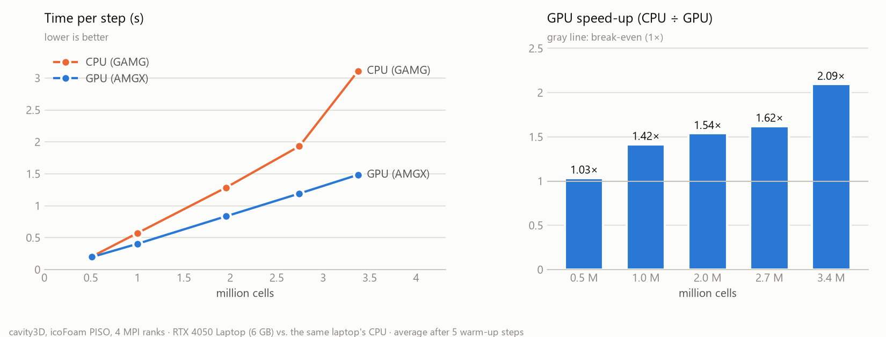
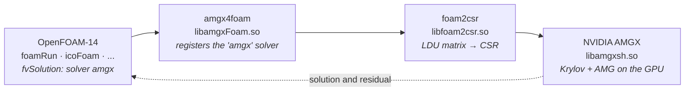
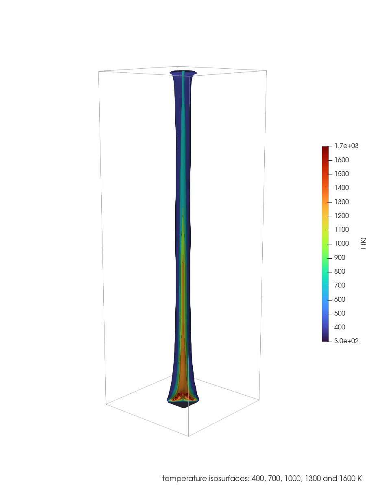
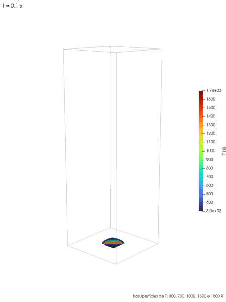
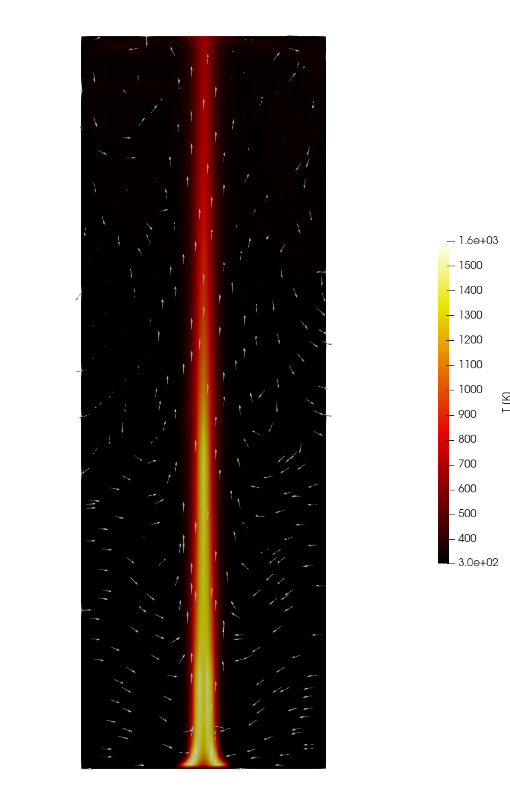
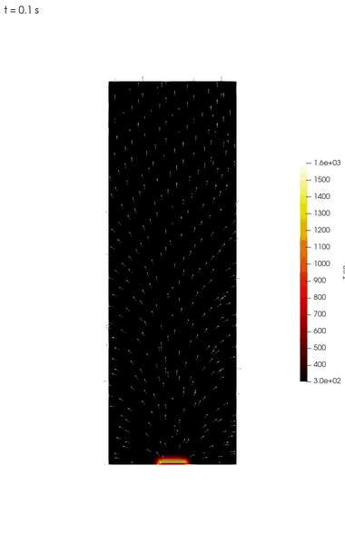
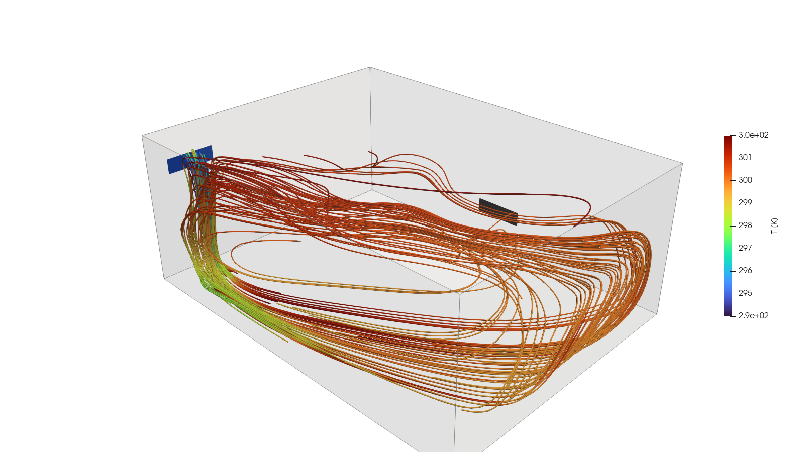
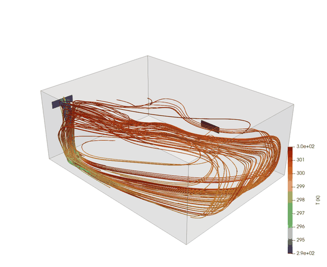
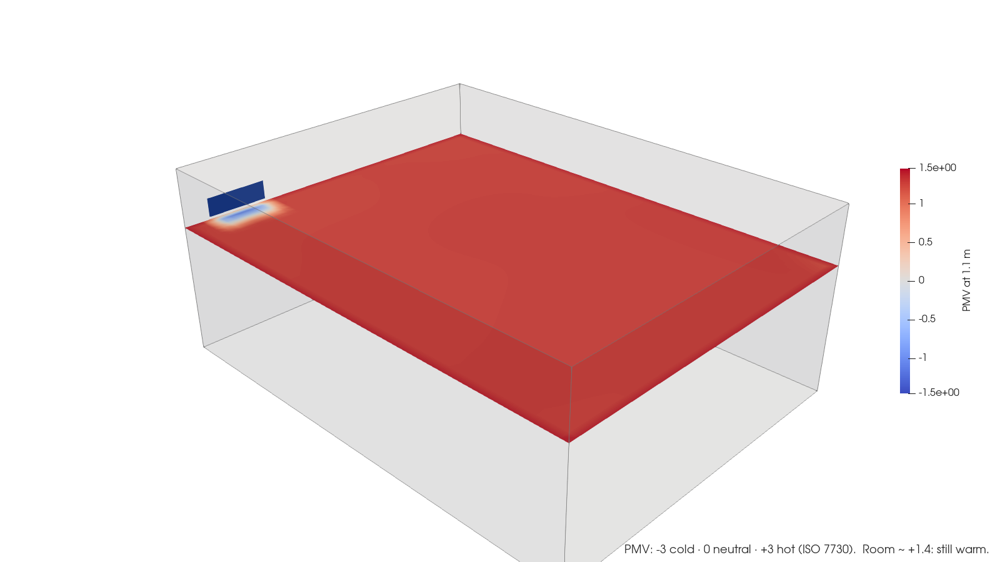
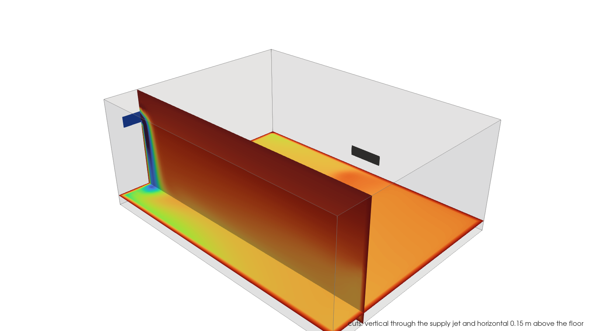

<h1 align="center">openFoam-14-cuda</h1>

<p align="center">
  <b>OpenFOAM-14 (OpenFOAM Foundation) with the pressure solver on the GPU via NVIDIA AMGX</b><br>
  without changing a single line of the Foundation source code
</p>

<p align="center">
  
  
  
  
  
  
</p>

<p align="center"><b>English</b> · <a href="README.pt-BR.md">Português</a></p>

<p align="center">
  <picture>
    <source media="(prefers-color-scheme: dark)" srcset="cuda/docs/gpu_scaling_dark.png">
    
  </picture>
</p>

**The bigger the mesh, the more the GPU wins.** Transient cavity3D (`icoFoam`, PISO), 4 MPI ranks,
RTX 4050 Laptop vs. the same laptop's CPU
([case](tutorials/GPU/cavity3D/), [details](cuda/benchmarks/cavity3D.md)):

| Mesh | CPU (GAMG) | GPU (AMGX) | Speed-up | p iterations, CPU / GPU |
|---|---:|---:|---:|---:|
| 80³ = 0.5 M cells | 0.204 s/step | 0.197 s/step | 1.03× | 3.9 / 5.3 |
| 100³ = 1.0 M | 0.570 | 0.403 | **1.42×** | 7.8 / 5.7 |
| 125³ = 2.0 M | 1.283 | 0.834 | **1.54×** | 8.7 / 5.7 |
| 140³ = 2.7 M | 1.932 | 1.192 | **1.62×** | 9.8 / 5.5 |
| 150³ = 3.4 M | 3.110 | 1.485 | **2.09×** | 14.6 / 5.6 |

GAMG iterations grow with the mesh; AMGX stays at ~5.5. Measured on 2026-10-11 with the machine
idle (other programs closed). A 4.9 M mesh did not fit in this machine's 8 GB of WSL RAM, which
is the limit of the test, not of the GPU.

<p align="center">
  
  
  <br>
  <sub>motorBike from the OpenFOAM-14 tutorials (3.2 M cells, 500 SIMPLE iterations), the case used in the GPU benchmarks: surface pressure with streamtubes (left) and the wake on the symmetry plane (right). ParaView.</sub>
</p>

> **Community fork, not official.** Not affiliated with or endorsed by the OpenFOAM Foundation
> or ESI/OpenCFD. OpenFOAM® is a registered trademark of the OpenFOAM Foundation.

## Contents

- [What this fork does](#what-this-fork-does)
- [Status and results](#status-and-results) · [Gallery](#gallery)
- [1. Prerequisites](#1-prerequisites)
- [2. Download](#2-download)
- [3. Build OpenFOAM-14](#3-build-openfoam-14)
- [4. Build the GPU part](#4-build-the-gpu-part)
- [5. Use the GPU in a case](#5-use-the-gpu-in-a-case)
- [6. Validate before trusting it](#6-validate-before-trusting-it)
- [When the GPU pays off](#when-the-gpu-pays-off)
- [Troubleshooting](#troubleshooting)
- [What was fixed in the third-party projects](#what-was-fixed-in-the-third-party-projects)
- [Repository layout](#repository-layout)
- [Roadmap](#roadmap) · [Acknowledgements](#acknowledgements) · [Credits and license](#credits-and-license)

## What this fork does

OpenFOAM assembles the equations on the CPU. This fork adds a **linear solver** called
`amgx` that sends the pressure-equation matrix to the GPU, solves it with NVIDIA's algebraic
multigrid (AMGX) and returns the solution. To OpenFOAM it is just another option in
`fvSolution`, like `GAMG` or `PCG`.



| Layer | Role | Origin |
|---|---|---|
| [AMGX](https://github.com/NVIDIA/AMGX) | algebraic multigrid in CUDA | NVIDIA, used unchanged |
| [foam2csr](https://github.com/mattmartineau/foam2csr) | converts OpenFOAM's LDU matrix to CSR and talks to AMGX | NVIDIA (M. Martineau), patched |
| [amgx4foam](https://github.com/maorz1998/amgx4foam) | registers `amgx` as an `lduMatrix::solver` | community, **ported to the OpenFOAM-14 API** |

It also builds OpenFOAM-14 with **Intel oneAPI** (`icx`/`icpx`), using the rules that already
ship with the Foundation.

## Status and results

| Item | Result |
|---|---|
| OpenFOAM-14 with GCC 11.4 | ✅ ~145 solvers and utilities |
| OpenFOAM-14 with Intel oneAPI 2026.1 | ✅ final pressure **bit-for-bit identical** to the GCC build (cavity) |
| `amgx` solver on the GPU | ✅ cavity and motorBike converge and match the CPU |
| Performance, transient cavity3D (PISO) | ✅ GPU **1.03×** (0.5 M cells) to **2.09×** (3.4 M) faster, growing with the mesh ([details](cuda/benchmarks/cavity3D.md)) |
| Performance, motorBike 3.2 M cells | ⚖️ GPU **ties** with the CPU (2.48 vs. 2.55 s/iteration) in steady state |

**motorBike, 3,215,800 cells, 4 MPI ranks, average of iterations 10–100:**

| Configuration | s / iteration | p solver iterations | Cd (it. 100) |
|---|---:|---:|---:|
| CPU, GAMG (`relTol 0.1`) | 2.550 | 2.0 | 0.7210 |
| GPU, AMGX `tolerance 0.1` | 2.522 | 1.4 | 0.7214 |
| GPU, AMGX `tolerance 0.1` + AMG structure reuse | **2.478** | 1.4 | 0.7200 |

Why it only ties, and where the GPU should win: see [When the GPU pays off](#when-the-gpu-pays-off)
and [`cuda/benchmarks/motorBike.md`](cuda/benchmarks/motorBike.md).

**Tested environment:** RTX 4050 Laptop (6 GB, compute capability 8.9) · Windows 11 + WSL2 ·
Ubuntu 22.04 · CUDA 13.2 · driver 596.08 · GCC 11.4 · Intel oneAPI 2026.1 · OpenMPI 4.1.

## Gallery

Other cases run with this fork, **on the CPU** (in these two the pressure solve is a small part
of the step, so the GPU would not help; see [`tutorials/GPU`](tutorials/GPU/)). Figures made in
ParaView with [`cuda/scripts/render_poolfire.py`](cuda/scripts/render_poolfire.py) and
[`cuda/scripts/render_hvac.py`](cuda/scripts/render_hvac.py).

**Methane pool fire**: `multicomponentFluid/smallPoolFire3D`, with the domain extended from
1 m to 3 m in height (60 × 180 × 60 = 648 k cells), 4 s of simulated time.

<p align="center">
  
  
  
  <br>
  <sub>Isosurfaces from 400 to 1600 K clipped in half (left), evolution from 0.1 to 4 s (center) and
  temperature on the mid-plane with velocity arrows (right). The flame (above ~1200 K) ends at
  about 1.5 m; above it rises the plume of hot gases.</sub>
</p>

<p align="center">
  
  <br>
  <sub>Temperature on the mid-plane from 0.1 to 4 s: the ignition "mushroom" rises and the flame
  settles at ~1.5 m.</sub>
</p>

**Room ventilation and cooling**: `fluid/hotRoomComfort`, 17 °C air supplied at 0.2 m/s into a
29 °C room, steady state (48 k cells), with PMV/PPD thermal comfort.

<p align="center">
  
  
  
  <br>
  <sub>The cold air drops right after leaving the grille, runs along the floor and returns warm along
  the ceiling (left and center). At 1.1 m height the PMV is ~+1.4, slightly warm (right): at this
  flow rate the room does not reach comfort.</sub>
</p>

<p align="center">
  
  <br>
  <sub>Temperature on a vertical cut through the supply jet and a horizontal cut 0.15 m above the
  floor: the cold air falls along the wall and forms a cold layer over the floor.</sub>
</p>

---

## 1. Prerequisites

### Hardware

| Requirement | Minimum | Note |
|---|---|---|
| NVIDIA GPU | compute capability **≥ 7.0** (Volta or newer) | `nvidia-smi --query-gpu=name,compute_cap --format=csv` |
| GPU memory | 4 GB | motorBike (3.2 M cells) used ~2.6 GB |
| RAM | 16 GB recommended | building OpenFOAM takes several GB |
| Disk | ~25 GB free | OpenFOAM, AMGX and cases |

### Operating system

- **Ubuntu 22.04**, native or on **WSL2** (Windows 11).
- On WSL2 the NVIDIA driver is the **Windows** one. Do not install a driver inside Ubuntu.
- On WSL2, leave at least half of the RAM to Windows in `%USERPROFILE%\.wslconfig`
  and apply it with `wsl --shutdown`:

  ```ini
  [wsl2]
  memory=8GB
  swap=4GB
  ```

### Ubuntu packages

```bash
sudo apt-get update
sudo apt-get install -y build-essential flex bison cmake git \
    zlib1g-dev libboost-system-dev libboost-thread-dev \
    libopenmpi-dev openmpi-bin libreadline-dev libncurses-dev libxt-dev rpm \
    libscotch-dev libptscotch-dev \
    libpetsc-real-dev libtrilinos-zoltan-dev
```

`libpetsc-real-dev` and `libtrilinos-zoltan-dev` are only build dependencies (of the GPU part
and of the Zoltan decomposition). No PETSc solver is used.

### CUDA Toolkit (tested with 13.2)

AMGX and foam2csr need C++17, available since CUDA 11. Only CUDA 13.2 was tested;
`env.sh` also finds CUB where older versions put it.

**WSL2**: use the `wsl-ubuntu` repository. The generic package tries to install a Linux
driver, which conflicts with the Windows driver.

```bash
wget https://developer.download.nvidia.com/compute/cuda/repos/wsl-ubuntu/x86_64/cuda-keyring_1.1-1_all.deb
sudo dpkg -i cuda-keyring_1.1-1_all.deb
sudo apt-get update
sudo apt-get install -y cuda-toolkit-13-2
```

**Native Ubuntu**: the same, replacing `wsl-ubuntu` with `ubuntu2204` in the URL.

```bash
export PATH=/usr/local/cuda/bin:$PATH
nvcc --version     # release 13.2 (or the installed version)
which nvcc         # /usr/local/cuda/bin/nvcc
```

> ⚠️ If `which nvcc` shows `/usr/bin/nvcc`, the old `nvidia-cuda-toolkit` package (CUDA 11.5)
> is installed and first in the PATH. It does not know recent GPUs and breaks the build.

### Intel oneAPI (optional)

Only to build OpenFOAM with Intel. The GPU part uses GCC.

```bash
wget -O- https://apt.repos.intel.com/intel-gpg-keys/GPG-PUB-KEY-INTEL-SW-PRODUCTS.PUB \
  | gpg --dearmor | sudo tee /usr/share/keyrings/oneapi-archive-keyring.gpg > /dev/null
echo "deb [signed-by=/usr/share/keyrings/oneapi-archive-keyring.gpg] https://apt.repos.intel.com/oneapi all main" \
  | sudo tee /etc/apt/sources.list.d/oneAPI.list
sudo apt-get update
sudo apt-get install -y intel-oneapi-compiler-dpcpp-cpp intel-oneapi-compiler-fortran
```

---

## 2. Download

The directory **must** be called `OpenFOAM-14`: `etc/bashrc` builds its paths from that name.

```bash
mkdir -p ~/dev && cd ~/dev
git clone https://github.com/ileaof/openFoam-14-cuda.git OpenFOAM-14
cd OpenFOAM-14
```

## 3. Build OpenFOAM-14

### GCC (default)

```bash
cd ~/dev/OpenFOAM-14
source etc/bashrc
./Allwmake -j 4 > log.Allwmake 2>&1      # 1 to 2 hours, depending on the machine
ls $FOAM_APPBIN | wc -l                  # ~145
```

- Use `-j` with at most half of the cores: each compile process takes 1 to 2 GB of RAM.
- Errors in `PVReaders` (the ParaView readers) are expected without ParaView installed in Ubuntu and do not affect the solvers.

### Intel oneAPI (optional)

The `icx` rules already exist in the Foundation (`wmake/rules/linux64Icx`). The build goes to
`platforms/linux64IcxDPInt32Opt` and does not overwrite the GCC build.

```bash
source /opt/intel/oneapi/setvars.sh
source ~/dev/OpenFOAM-14/etc/bashrc WM_COMPILER=Icx
cd ~/dev/OpenFOAM-14 && ./Allwmake -j 4 > log.Allwmake.icx 2>&1
```

### Quick test

```bash
source ~/dev/OpenFOAM-14/etc/bashrc
cp -r $FOAM_TUTORIALS/legacy/incompressible/icoFoam/cavity/cavity ~/cavity && cd ~/cavity
blockMesh && icoFoam | tail -3           # ends with "End"
```

## 4. Build the GPU part

With OpenFOAM-14 built with GCC, one command clones AMGX, foam2csr and amgx4foam at the
tested commits, applies the [patches](cuda/patches/) and builds everything. The argument is the
compute capability **without the dot**:

| GPU (examples) | compute capability | argument |
|---|---|---|
| RTX 40xx (Ada) | 8.9 | `89` |
| RTX 30xx, A10, A40 (Ampere) | 8.6 | `86` |
| A100 | 8.0 | `80` |
| RTX 20xx, T4 (Turing) | 7.5 | `75` |
| V100 (Volta) | 7.0 | `70` |

```bash
cd ~/dev/OpenFOAM-14
bash cuda/scripts/build_all.sh 89        # 30 to 60 min, mostly AMGX
```

It ends with `OK: libamgxFoam.so ready`. The dependencies go to `~/dev`
(change it with `export CUDA_DEPS_DIR=...`).

## 5. Use the GPU in a case

In every new terminal:

```bash
source ~/dev/OpenFOAM-14/cuda/scripts/env.sh
```

In the case, change three files:

**`system/controlDict`**: load the library
```
libs            ("libamgxFoam.so");
```

**`system/fvSolution`**: replace only the `p` block
```
p
{
    solver          amgx;
    amgx
    {
        dict p;
    }
}
```

**`system/amgxpOptions`**: copy from [`cuda/config/amgxpOptions`](cuda/config/amgxpOptions) and
set `"tolerance"` to the same value as the `relTol` you would use on the CPU.

> ⚠️ The `tolerance`/`relTol` in `fvSolution` **is ignored** by the GPU. `amgxpOptions` decides when to stop.

The AMGX recipe matters too: the default (FGMRES + classical AMG, PMIS) was the fastest of nine
tested on the cavity3D. To compare recipes on your own case, use
[`cuda/scripts/tune_amgx.py`](cuda/scripts/tune_amgx.py). A complete, ready-to-run example is in
[`tutorials/GPU/cavity3D`](tutorials/GPU/cavity3D/).

Always run **decomposed and in parallel**, with 2 to 4 ranks per GPU:

```bash
decomposePar
mpirun -np 4 foamRun -parallel           # or the case's solver, with -parallel
```

In the log, the pressure shows up as `AMGx:  Solving for p, ...` instead of `GAMG:` or `DICPCG:`.

## 6. Validate before trusting it

Run the cavity on the CPU and on the GPU, on the same 2 ranks, and compare the final pressure:

| Build | Final p residual | Comparison |
|---|---|---|
| GCC, CPU (DICPCG) | 8.638e-07 | reference |
| Intel oneAPI, CPU (DICPCG) | 8.638e-07 | bit-for-bit identical |
| AMGX, GPU (PCG + AMG) | 5.248e-19 | same physics; ~1e-4 difference in the field |

The difference is not zero, and it should not be: different iterative methods reach the same
solution along different paths, both within the tolerance. The full walkthrough, with expected
output and images, is in [`cuda/docs/tutorial.html`](cuda/docs/tutorial.html)
(download it and open it in a browser).

## When the GPU pays off

On the motorBike (SIMPLE, steady state), the AMGX pressure solve takes **0.26 s** of each
**2.48 s** iteration, about **10%**. The rest (velocity, turbulence, matrix assembly,
post-processing) stays on the CPU. By Amdahl's law, even an instant pressure solve would give at
most ~12% speed-up.

The GPU pays off when **the pressure dominates the iteration**. On the cavity3D (transient PISO,
`pFinal` with `relTol 0.001`), the GPU is **1.42×** faster at 1 M cells and **2.09×** at
3.4 M: GAMG iterations grow with the mesh (3.9 → 14.6), AMGX stays at ~5.5.
Signs of a favorable case:

- **transient** flows (PISO/PIMPLE) with several pressure correctors;
- `pFinal` with `relTol 0`, which forces deep solves;
- large meshes (hundreds of thousands of cells and up).

A quick check before investing in a case: in the CPU log, if `GAMG` takes only 1 to 3
iterations per pressure solve, the pressure is already cheap and the GPU has little to gain.

## Troubleshooting

| Symptom | Cause and fix |
|---|---|
| `nvcc fatal: Unsupported gpu architecture 'compute_70'` | wrong architecture. Run `build_all.sh` with your GPU's compute capability |
| `Unknown symmetric matrix solver amgx` | missing `libs ("libamgxFoam.so");` in `controlDict`, or `env.sh` was not sourced |
| `MPI_Get_processor_name() ... before MPI_INIT` | ran without `mpirun ... -parallel` |
| `attempt to run parallel on 1 processor` | OpenFOAM needs at least 2 subdomains with `-parallel` |
| `Cuda failure: 'out of memory'` / `'unknown error'` + `Out of resource` | GPU memory exhausted: close ParaView, games and browsers; use fewer MPI ranks. On WSL2, also check Windows' free memory |
| GPU much slower than the CPU | `tolerance` in `amgxpOptions` tighter than the CPU's `relTol` (see §5) or a mesh that is too small |
| Result differs from the CPU even though it converges | `caching { update periodic; }` (or `adaptive`/`never`) in `fvSolution`. **Do not use it**: the matrix stops being updated |
| `Residual history was not recorded` | missing `"store_res_history": 1` in `amgxpOptions` (already in this repository's file) |
| Wrong `WM_PROJECT_DIR` / files not found on `source etc/bashrc` | the directory is not called `OpenFOAM-14` (§2) |
| WSL2 hangs or restarts during the build or a run | WSL RAM too high in `.wslconfig`, or Windows out of free memory; lower `-j`, close other programs, `wsl --shutdown` to free the page cache |

More details in [`cuda/README.md`](cuda/README.md).

## What was fixed in the third-party projects

foam2csr and amgx4foam were written for older versions of OpenFOAM and CUDA.
All fixes are in the [patches](cuda/patches/); none touches the OpenFOAM Foundation code.

| # | Project | Problem | Fix |
|---|---|---|---|
| 1 | both | `/* */` comment in a Makefile (`missing separator`) | `#` |
| 2 | foam2csr | hard-coded `sm_70` architecture | `NVARCH` comes from `build_all.sh` |
| 3 | foam2csr | CUDA 13 (CCCL/CUB) needs C++17 | `-std=c++17` |
| 4 | foam2csr | `mpi.h` not found | `$(PFLAGS) $(PINC)` in `EXE_INC` |
| 5 | amgx4foam | hard-coded path `/usr/local/cuda-11.6` | `/usr/local/cuda` |
| 6 | amgx4foam | `-lfoam_csr` and output `libpetscFoam` | `-lfoam2csr` and `libamgxFoam` |
| 7 | amgx4foam | `MeshObject` does not exist in v14 | `DemandDrivenMeshObject<…, DeletableMeshObject, …>` |
| 8 | amgx4foam | `cyclicAMILduInterface.H` removed in v14 | include dropped (it was unused) |
| 9 | amgx4foam | `thisDb()` became `db()` in v14 | renamed |
| 10 | amgx4foam | `isFile` undeclared | `#include "OSspecific.H"` |
| 11 | amgx4foam | `const double*` passed as `PetscScalar*` | `const_cast` at the call site |
| 12 | amgx4foam | PETSc never initialized (segfault in `PetscPrintf`) | `PetscInitializeNoArguments()` guarded by `PetscInitialized()` |
| 13 | config | residual not returned to OpenFOAM | `"store_res_history": 1` |

In addition, library names from Ubuntu's packaging (`libpetsc_real.so`,
`libtrilinos_zoltan.so`) are resolved with symbolic links in `~/dev/compat/lib`,
without touching the system.

## Repository layout

```
OpenFOAM-14/                original OpenFOAM Foundation tree (unchanged)
├── cuda/
│   ├── README.md           integration details and pitfalls
│   ├── patches/            foam2csr.patch, amgx4foam.patch
│   ├── scripts/            env.sh, build_all.sh, tune_amgx.py (recipes), render_*.py, plot_scaling.py
│   ├── config/             recommended amgxpOptions (PMIS)
│   ├── benchmarks/         cavity3D.md, motorBike.md
│   └── docs/               tutorial.html, report.html, images
├── tutorials/GPU/          ready-to-run cases with the pressure on the GPU (cavity3D)
├── apple/                  OpenFOAM on Apple Silicon (planned, not yet tested)
├── README.md               this file (English)
├── README.pt-BR.md         this file in Portuguese
└── README.org              original OpenFOAM README
```

## Roadmap

- [x] Import the full OpenFOAM-14 history
- [x] Build with GCC
- [x] Build with Intel oneAPI
- [x] Pressure solver on the GPU (AMGX), validated against the CPU
- [x] CPU vs. GPU benchmark in steady state (motorBike, 3.2 M cells)
- [x] Transient benchmark (cavity3D, PISO): GPU from 1.03× (0.5 M) to 2.09× (3.4 M)
- [x] Ready-to-run tutorials in `tutorials/GPU/`
- [ ] Apple Silicon: build and validate the fork on aarch64, CPU benchmark ([plan](apple/README.md))
- [ ] Apple Silicon: find out whether there is a viable path for the pressure on Apple's GPU (Metal)
- [ ] Apply to the WiebePy combustion case (OpenFOAM 13)

## Acknowledgements

This work was supported by the Brazilian National Council for Scientific and Technological
Development (**CNPq**), the Coordination for the Improvement of Higher Education Personnel
(**CAPES**) and the Federal University of Pará (**UFPA**).

<p align="center">
  <a href="https://www.gov.br/cnpq"></a>
  &nbsp;&nbsp;&nbsp;&nbsp;
  <a href="https://www.gov.br/capes"></a>
  &nbsp;&nbsp;&nbsp;&nbsp;
  <a href="https://ufpa.br"></a>
</p>

## Credits and license

- [OpenFOAM](https://openfoam.org): OpenFOAM Foundation, GPL-3.0. The upstream commit and tag history is preserved.
- [AMGX](https://github.com/NVIDIA/AMGX): NVIDIA, BSD-3-Clause.
- [foam2csr](https://github.com/mattmartineau/foam2csr): M. Martineau (NVIDIA).
- [amgx4foam](https://github.com/maorz1998/amgx4foam): maorz1998, derived from the petsc4Foam module (OpenCFD / S. Bnà).

This repository distributes OpenFOAM-14 under GPL-3.0 (see [COPYING](COPYING)) and only
**patches** on top of foam2csr and amgx4foam. The original OpenFOAM documentation is in
[README.org](README.org).
