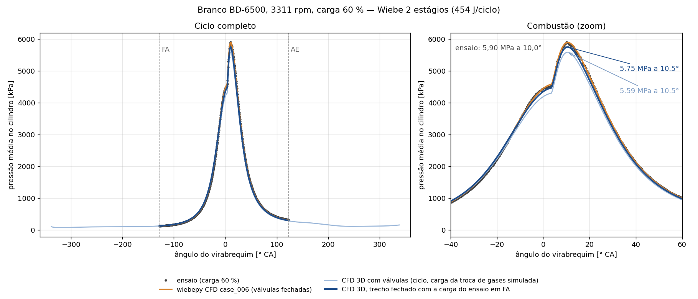
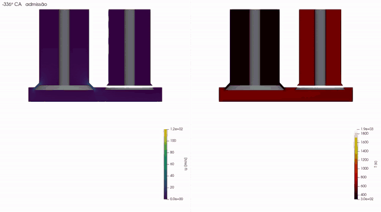

# Branco BD-6500 diesel engine — 3D cycle with moving valves

OpenFOAM-14 example case (`foamRun -solver fluid`): intake, compression, combustion, expansion and exhaust of a single-cylinder engine, with the piston and two valves moving. The mesh is swapped every 10–20 crank-angle degrees (`meshToMesh`), and the heat release follows a 2-stage Wiebe function fitted to the engine test.

*[Português](README.pt-BR.md)*



**Comparison with the Wiebe model.** The plot overlays the engine test (dots), the wiebepy CFD
case_006 (orange: the same 2-stage Wiebe heat release in a closed-valve case) and the two 3D runs
with moving valves:

| Curve | p_max | Angle | vs. test |
|---|---|---|---|
| Engine test (60 % load) | 5.90 MPa | 10.0° | — |
| wiebepy CFD case_006, closed valves, 2-stage Wiebe | follows the test | | |
| 3D, closed segment (IVC→EVO) starting from the test charge at IVC | 5.75 MPa | 10.5° | −2.5 % |
| 3D, full cycle, charge from the simulated gas exchange | 5.59 MPa | 10.5° | −5.3 % |

With the test charge at IVC, the 3D case with the Wiebe heat release lands close to the test and to
case_006. The two 3D curves differ only in the charge trapped at IVC, so the extra drop of the full
cycle comes from the simulated gas exchange, not from the combustion model.

[](imagens/motor3d_ciclo_v1.mp4)

*Version 1 cycle, −360° to +360°: velocity magnitude (left) and temperature (right) on the plane
through both valves. Click the image for the full MP4 (1800×1000, 17 s).*

## Engine data

| | |
|---|---|
| Bore × stroke, connecting rod | 86 × 70 mm, 117.5 mm |
| Compression ratio | 17 nominal; 15.14 effective (wiebepy fit) |
| Operating point | 3311 rpm, 60 % load |
| Valves | IVC 128° before TDC, EVO 123° after TDC (engine data sheet); IVO/EVC 16° (estimated) |
| Maximum lift, valve heads | 7.5 mm; 38 mm (intake) and 32 mm (exhaust) (estimated) |
| Heat released | 454 J/cycle (1.158×10⁻⁵ kg of diesel × 39 191 kJ/kg) |
| Wiebe (2 stages) | β 0.6456 / 0.3544; θ₀ −19.33° / 3.66°; Δθ 64.40° / 18.93°; m 2.555 / 0.368; a 6.908 |

Convention: 0° is combustion TDC; the cycle runs from −360° to +360°. The z axis points up, with the flat cylinder head at z = 0, the intake at x < 0 and the exhaust at x > 0.

## Requirements

- OpenFOAM-14 built and loaded (`source <OpenFOAM-14>/etc/bashrc`).
- Python 3 with `scripts/requirements.txt` (`trimesh`, `manifold3d`, `numpy`, `scipy`, `matplotlib`). A venv is best. On Ubuntu 22.04 without a venv, using the system scipy, install `"numpy<2"`.
- 4 cores and about 8 GB of RAM. Disk: about 35 GB for the 3 cycles with the default write settings.

The case uses CPU linear solvers (GAMG/PBiCGStab). Its meshes have 225 to 350 thousand cells, below the size at which the [GPU benchmarks](../../cuda/benchmarks/cavity3D.md) of this repository show a gain.

## How to run

```bash
./Allmesh            # geometry + 62 meshes (NJOBS=3 in parallel; about 1 h)
./Allrun             # assembles run/ and runs 3 cycles (4 ranks; about 1.5 to 2 days on an i5-12450HX)
./Allrun -retoma     # resumes from the last written time if the run is interrupted
./Allrun -monta      # only assembles and decomposes the case, without running
./Allclean
```

At the end, `pressao_ciclos.png` compares the mean cylinder pressure of each cycle with the test (`dados/ensaio_P_carga60.csv`).

Quick smoke test (about 10 min), on a copy of this folder:

```bash
printf -- "-360\n-50\n" > angulos.txt   # only 2 angles
NJOBS=2 ./Allmesh                         # should report "aceitas: 2 | rejeitadas: 0" (accepted / rejected)
./Allrun -monta                           # should end with "caso montado com 2 malhas" (case assembled with 2 meshes)
```

## How it works

1. **Geometry** (`scripts/geometria.py <CA> <folder>`): solid boolean operations (manifold3d) of the cylinder, ports and valves at the piston position and valve lift of that angle. It writes `fluido.stl`, with regions named from each triangle's source id, and `info.txt`. The cam profile is `L·sin(πf)^p`, with `p` chosen so that the lift goes through 1.5 mm exactly at IVC and EVO.
2. **Mesh** (`scripts/malha.sh`): 1.5 mm blockMesh, refined at the valve heads and seats, followed by snappyHexMesh. If checkMesh fails, there are up to 5 attempts with the background mesh shifted and explicit or implicit snapping (`scripts/malha_angulo.sh`). A mesh is accepted with "Mesh OK" or if the only failure is skewness, with a maximum below 10. Rejected angles are left out of the list.
3. **Case** (`Allrun`): `multiValveEngine` moves the piston and the valves between meshes, and `meshToMesh` switches to the next mesh at the times in `constant/meshTimes`, repeating every 720°. The `heatSource` applies `q''' = Q_Wiebe(CA)/V_cylinder(CA)` in the `cilindro` zone (z < 0). The run is split into segments with their own time step: maxCo 1 and a maximum step of 0.05° during combustion (−30° to +50°); a 0.05° step during intake and exhaust.

## Important details

- **Case time = CA + 360.** OpenFOAM-14's `meshToMesh` converts the mesh time into an index with `int64_t((t + Δ/2)/Δ)` (`src/fvMeshTopoChangers/meshToMesh/meshToMesh_fvMeshTopoChanger.C`, lines 141 and 236). That expression truncates negative times the wrong way, and the meshes for CA < 0 would not be found. So the case shifts time by +360: cycle 1 runs from 0 to 720, cycle 2 from 720 to 1440 and cycle 3 from 1440 to 2160.
- **Closed valve.** The mover stops the valve at `minLift` = 1.5 mm. The geometry does the same: the closed valve sits at 1.5 mm, and a seal ring flush with the cylinder head closes the gap. That way the closed-valve position is the same in the geometry and in the mover.
- **Stray faces at the seal** (`scripts/conserta_selo.sh`). snappyHexMesh leaves isolated patches of `ivHead`/`evHead` on top of the seal ring. If one of those has no counterpart in the next mesh, `meshToMesh` aborts with *"Un-mapped face … not connected to a mapped cell by the stabilisation wave"*. So, in each mesh, the closed valve's faces on the seal plane are moved to `ivSeat`/`evSeat`. The boundary conditions are the same (T = 440 K, zero velocity with the valve at rest), so the physics does not change.
- **`q` instead of `Q`** in the `heatSource`. With `Q` (total), OF-14 divides by the zone volume computed only once, when the case is read. Near TDC that applied only about 7 % of the heat.
- **`hierarchical (2 2 1)` decomposition.** The x = 0 and y = 0 planes cut each valve into continuous halves. With scotch, isolated surface fragments were left on one rank, which broke the mapping.

## Results

| Case | p_max | Angle |
|---|---|---|
| Engine test (60 % load) | 5.90 MPa | 10.0° |
| Version 1: one cycle, charge from simulated gas exchange | 5.59 MPa | — |
| Closed segment (IVC→EVO) starting from the test charge at IVC | 5.75 MPa | 10.5° |
| Version 2 (this case), cycle 1 | 5.28 MPa | 10.9° |
| Version 2, cycle 3 | *(to be filled in)* | |

Cycle 1 starts from an arbitrary initial state (105 kPa, 750 K, with exhaust gas in the ports). Cycles 2 and 3 start from the charge and residual gas produced by the simulated gas exchange.

## Files

```
Allmesh, Allrun, Allclean
angulos.txt              mesh angles (CA)
malha/system/            blockMesh/snappyHexMesh template (placeholders filled in by malha.sh)
caso/0.orig, constant/, system/
scripts/                 geometria.py, malha.sh, malha_angulo.sh, aceita.sh, conserta_selo.sh,
                         gera_tabelas.py (lift), gera_wiebe_q.py (q'''), grafico_ciclos.py
dados/ensaio_P_carga60.csv   measured pressure (θ [rad], p [kPa])
imagens/                 version 1 results (pressure plot, MP4 and its GIF preview)
```

The scripts and the console messages are in Portuguese; the names above are kept as they are because the scripts depend on them.
