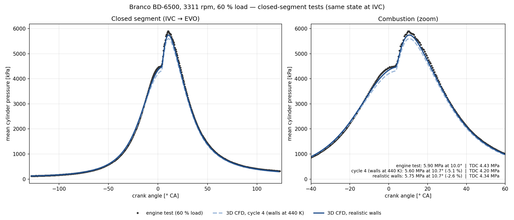
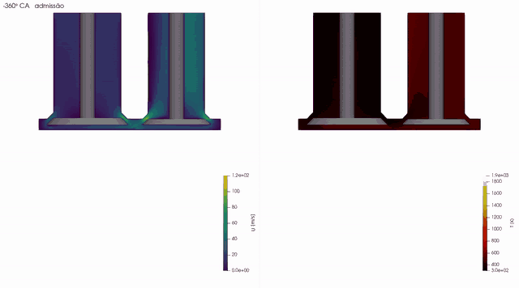
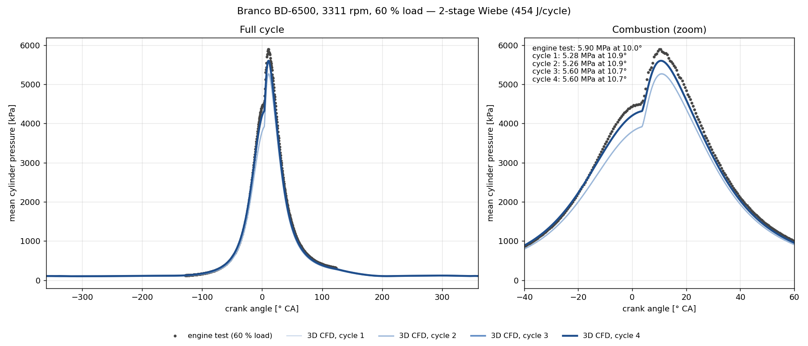

# Branco BD-6500 diesel engine — 3D cycle with moving valves

OpenFOAM-14 example case (`foamRun -solver fluid`): intake, compression, combustion, expansion and exhaust of a single-cylinder engine, with the piston and two valves moving. The mesh is swapped every 10–20 crank-angle degrees (`meshToMesh`), and the heat release follows a 2-stage Wiebe function fitted to the engine test with wiebepy.

*[Português](README.pt-BR.md)*



With realistic wall temperatures, the 3D case driven by the 2-stage Wiebe heat release reaches **R² = 0.9992** against the engine test over the closed part of the cycle (IVC→EVO), with the peak pressure 2.6 % below the test (see [Results](#results)).

[](imagens/motor3d_ciclo.mp4)

*Cycle 4 (walls at 440 K), −360° to +360°: velocity magnitude (left) and temperature (right) on the plane through both valves. Click the image for the full MP4 (1800×1000, 20 s).*

## Engine data

| | |
|---|---|
| Bore × stroke, connecting rod | 86 × 70 mm, 117.5 mm |
| Compression ratio | 17 nominal; 15.14 effective (wiebepy fit) |
| Operating point | 3311 rpm, 60 % load |
| Valves | IVC 128° before TDC, EVO 123° after TDC (engine data sheet); IVO/EVC 16° (estimated) |
| Maximum lift, valve heads | 7.5 mm; 38 mm (intake) and 32 mm (exhaust) (estimated) |
| Heat released | 454 J/cycle (1.158×10⁻⁵ kg of diesel × 39 191 kJ/kg) |
| Wiebe (2 stages) | β 0.6456 / 0.3544; θ₀ −19.33° / 3.66°; Δθ 64.40° / 18.93°; m 2.555 / 0.368; a 6.908 |

Convention: 0° is combustion TDC; the cycle runs from −360° to +360°. The z axis points up, with the flat cylinder head at z = 0, the intake at x < 0 and the exhaust at x > 0.

## Requirements

- OpenFOAM-14 built and loaded (`source <OpenFOAM-14>/etc/bashrc`).
- Python 3 with `scripts/requirements.txt` (`trimesh`, `manifold3d`, `numpy`, `scipy`, `matplotlib`). A venv is best. On Ubuntu 22.04 without a venv, using the system scipy, install `"numpy<2"`.
- 4 cores and about 8 GB of RAM. Disk: about 35 GB for 3 cycles with the default write settings.

The case uses CPU linear solvers (GAMG/PBiCGStab). Its meshes have 225 to 350 thousand cells, below the size at which the [GPU benchmarks](../../cuda/benchmarks/cavity3D.md) of this repository show a gain.

## How to run

```bash
./Allmesh            # geometry + 62 meshes (NJOBS=3 in parallel; about 1 h)
./Allrun             # assembles run/ and runs 3 cycles (4 ranks; about 14 h per cycle on an i5-12450HX)
NCICLOS=2 ./Allrun   # 2 cycles are enough to converge (cycles 3 and 4 differed by 0.02 % at the peak)
./Allrun -retoma     # resumes from the last written time if the run is interrupted
./Allrun -monta      # only assembles and decomposes the case, without running
./Allclean
```

At the end, `pressao_ciclos.png` compares the mean cylinder pressure of each cycle with the test (`dados/ensaio_P_carga60.csv`). For the same figure in English:

```bash
FIG_LANG=en python3 scripts/grafico_ciclos.py run dados/ensaio_P_carga60.csv pressao_ciclos_en.png
```

The default (without `FIG_LANG`) is Portuguese. The figures in `imagens/` exist in both languages: the name without a suffix is the Portuguese version (used in `README.pt-BR.md`), and the `_en` suffix marks the English version (used in this README).

Quick smoke test (about 10 min), on a copy of this folder:

```bash
printf -- "-360\n-50\n" > angulos.txt   # only 2 angles
NJOBS=2 ./Allmesh                         # should report "aceitas: 2 | rejeitadas: 0" (accepted / rejected)
./Allrun -monta                           # should end with "caso montado com 2 malhas" (case assembled with 2 meshes)
```

## How it works

1. **Geometry** (`scripts/geometria.py <CA> <folder>`): solid boolean operations (manifold3d) of the cylinder, ports and valves at the piston position and valve lift of that angle. It writes `fluido.stl`, with regions named from each triangle's source id, and `info.txt`. The cam profile is `L·sin(πf)^p`, with `p` chosen so that the lift goes through 1.5 mm exactly at IVC and EVO.
2. **Mesh** (`scripts/malha.sh`): 1.5 mm blockMesh, refined at the valve heads and seats, followed by snappyHexMesh. If checkMesh fails, there are up to 5 attempts with the background mesh shifted and explicit or implicit snapping (`scripts/malha_angulo.sh`). A mesh is accepted with "Mesh OK" or if the only failure is skewness, with a maximum below 10. Rejected angles are left out of the list.
3. **Case** (`Allrun`): `multiValveEngine` moves the piston and the valves between meshes, and `meshToMesh` switches to the next mesh at the times in `constant/meshTimes`, repeating every 720°. The `heatSource` applies `q''' = Q_Wiebe(CA)/V_cylinder(CA)` in the `cilindro` zone (z < 0). The run is split into segments with their own time step: maxCo 1 and a maximum step of 0.05° during combustion (−30° to +50°); maxCo 1 and 0.02° during the exhaust blowdown (+122° to +160°, sonic jet; with maxCo 3, cycle 2 aborted with a negative temperature); a 0.05° step during intake and the rest of the exhaust.

## Important details

- **Case time = CA + 360.** OpenFOAM-14's `meshToMesh` converts the mesh time into an index with `int64_t((t + Δ/2)/Δ)` (`src/fvMeshTopoChangers/meshToMesh/meshToMesh_fvMeshTopoChanger.C`, lines 141 and 236). That expression truncates negative times the wrong way, and the meshes for CA < 0 would not be found. So the case shifts time by +360: cycle 1 runs from 0 to 720, cycle 2 from 720 to 1440 and cycle 3 from 1440 to 2160.
- **Closed valve.** The mover stops the valve at `minLift` = 1.5 mm. The geometry does the same: the closed valve sits at 1.5 mm, and a seal ring flush with the cylinder head closes the gap. That way the closed-valve position is the same in the geometry and in the mover.
- **Stray faces at the seal** (`scripts/conserta_selo.sh`). snappyHexMesh leaves isolated patches of `ivHead`/`evHead` on top of the seal ring. If one of those has no counterpart in the next mesh, `meshToMesh` aborts with *"Un-mapped face … not connected to a mapped cell by the stabilisation wave"*. So, in each mesh, the closed valve's faces on the seal plane are moved to `ivSeat`/`evSeat`. With the valve at rest the velocity condition is the same (zero), and the temperature difference between head and seat over such a narrow band is negligible, so the physics does not change.
- **`q` instead of `Q`** in the `heatSource`. With `Q` (total), OF-14 divides by the zone volume computed only once, when the case is read. Near TDC that applied only about 7 % of the heat.
- **Calibrated inlet: `totalPressure` p0 = 111 kPa** (outlet: 105 kPa). With 1 bar at the inlet, the pressure at intake valve closing (IVC) was 110.8 kPa, against 123.3 kPa in the test. The real engine gains pressure from the dynamic effect of the intake runner, which the model lacks, since the inlet sits just above the valve. With 111 kPa, the simulated IVC pressure is 123.0 kPa.
- **Realistic wall temperatures** (`0.orig/T`): piston 560 K, head 500 K, liner 420 K, intake valve head and seat 520/500 K, exhaust valve head and seat 750/550 K, stems 450/650 K. These are typical ranges for a diesel at medium load (Heywood, ch. 12). With 440 K on every wall, the heat loss near TDC was excessive.
- **Limiters** (`system/fvConstraints`: `limitPressure` with a 20 kPa minimum, `limitTemperature` from 250 to 3500 K, `limitMag` of U up to 1000 m/s). During the exhaust blowdown, the wake of the valve head formed a near-vacuum pocket in one cell (p of 5 kPa, ρ of 0.03 kg/m³, \|U\| of 750 m/s and rising), and the time step dropped to 10⁻¹¹ s. The limits are outside the physical range of the engine: the pressure minimum acts only for a few degrees, in cells of the exhaust port, not in the cylinder. The `maximos`/`minimos` function objects in `controlDict` log where the extremes are, which helps locate this kind of problem.
- **`hierarchical (2 2 1)` decomposition.** The x = 0 and y = 0 planes cut each valve into continuous halves. With scotch, isolated surface fragments were left on one rank, which broke the mapping.

## Results

| Case | Inlet | p at IVC | p_max | Angle | Difference |
|---|---|---|---|---|---|
| Engine test (60 % load) | — | 123.3 kPa | 5.90 MPa | 10.0° | — |
| Cycles 1 and 2 | 100 kPa | 110.8 kPa | 5.28 / 5.26 MPa | 10.9° | −10.8 % |
| Cycle 3 | 111 kPa | 123.0 kPa | 5.60 MPa | 10.7° | −5.1 % |
| **Cycle 4 (converged)** | 111 kPa | 123.0 kPa | **5.60 MPa** | 10.7° | **−5.1 %** |

In this run (walls at 440 K), the inlet was calibrated from cycle 3 on. The compression followed the test up to about −20°, and the remaining difference was concentrated near TDC.



### Realistic walls (current setup of this case)

Test of the closed segment (−128° to +122°), starting from the same state as cycle 4 at IVC and changing only the wall temperatures:

| Case | p_max | Angle | Difference | R² (−128° to +122°) | R² (combustion, −40° to +60°) | RMSE (combustion) |
|---|---|---|---|---|---|---|
| Engine test | 5.90 MPa | 10.0° | — | — | — | — |
| Walls at 440 K (cycle 4) | 5.60 MPa | 10.7° | −5.1 % | 0.9964 | 0.9905 | 150 kPa (2.5 %) |
| **Realistic walls** | **5.75 MPa** | 10.7° | **−2.6 %** | **0.9992** | **0.9979** | **71 kPa (1.2 %)** |

R² and RMSE compare each test point with the simulated pressure interpolated at the same angle. With hotter walls, the curve between −20° and TDC lies practically on the test (`imagens/teste_paredes_en.png`).

### Versions of this example

| Version | Contents | Status |
|---|---|---|
| v1 | Calibrated inlet (111 kPa), limiters, 4 cycles with walls at 440 K (peak −5.1 %), cycle 4 animation | published |
| **v2 (this one)** | **Realistic walls** in `0.orig/T`; closed-segment test (peak −2.6 %, R² 0.9979 over combustion) | **complete** |
| v3 | Full-cycle confirmation with realistic walls (2 cycles) and a new animation of that cycle | running |

v2 is complete. The animation `imagens/motor3d_ciclo.mp4` is still the one of cycle 4 with walls at 440 K, and that is intentional: the v2 test covered only the closed segment. The animation with realistic walls and the full-cycle numbers will come in v3. Over the full cycle, the hotter walls also heat the charge during intake, so the gain may be somewhat smaller than in the closed segment.

## Files

```
Allmesh, Allrun, Allclean
angulos.txt              mesh angles (CA)
malha/system/            blockMesh/snappyHexMesh template (placeholders filled in by malha.sh)
caso/0.orig, constant/, system/
scripts/                 geometria.py, malha.sh, malha_angulo.sh, aceita.sh, conserta_selo.sh,
                         gera_tabelas.py (lift), gera_wiebe_q.py (q'''), grafico_ciclos.py (FIG_LANG=en: English)
dados/ensaio_P_carga60.csv   measured pressure (θ [rad], p [kPa])
imagens/                 teste_paredes.png / _en.png (v2: closed segment, realistic walls vs. 440 K vs. test);
                         pressao_4ciclos.png / _en.png and motor3d_ciclo.mp4 + GIF (v1: cycle 4, walls at 440 K,
                         cut through the valve plane, U and T; the realistic-wall animation will come in v3)
```

The scripts and the console messages are in Portuguese; the names above are kept as they are because the scripts depend on them.
