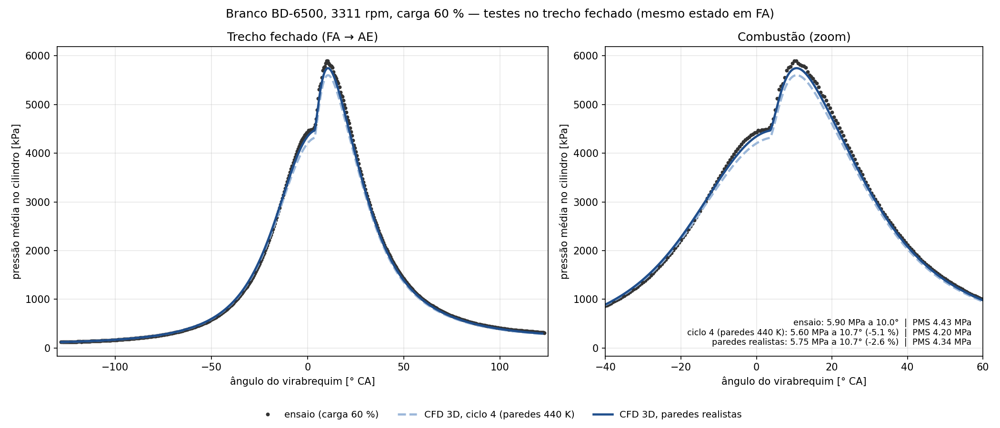
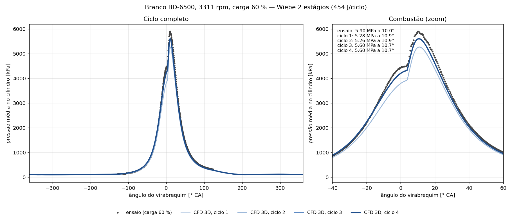

# Motor diesel Branco BD-6500 — ciclo 3D com válvulas móveis

Caso de exemplo do OpenFOAM-14 (`foamRun -solver fluid`): admissão, compressão, combustão, expansão e escape de um motor monocilíndrico, com pistão e duas válvulas em movimento. A malha é trocada a cada 10–20° de virabrequim (`meshToMesh`), e a liberação de calor segue uma função de Wiebe de 2 estágios, ajustada ao ensaio.

*[English](README.md)*



Com temperaturas de parede realistas, o caso 3D movido pela liberação de calor Wiebe de 2 estágios chega a **R² = 0,9992** contra o ensaio no trecho fechado do ciclo (FA→AE), com o pico de pressão 2,6 % abaixo do ensaio (veja [Resultados obtidos](#resultados-obtidos)).

[](imagens/motor3d_ciclo.mp4)

*Ciclo 4 (paredes a 440 K), de −360° a +360°: módulo da velocidade (esquerda) e temperatura (direita) no plano que passa pelas duas válvulas. Clique na imagem para o MP4 completo (1800×1000, 20 s).*

## Dados do motor

| | |
|---|---|
| Diâmetro × curso, biela | 86 × 70 mm, 117,5 mm |
| Taxa de compressão | 17 nominal; 15,14 efetiva (ajuste do wiebepy) |
| Ponto de operação | 3311 rpm, carga 60 % |
| Válvulas | FA 128° antes do PMS, AE 123° depois do PMS (ficha do motor); AA/FE 16° (estimados) |
| Lift máximo, pratos | 7,5 mm; 38 mm (adm.) e 32 mm (esc.) (estimados) |
| Calor liberado | 454 J/ciclo (1,158×10⁻⁵ kg de diesel × 39 191 kJ/kg) |
| Wiebe (2 estágios) | β 0,6456 / 0,3544; θ₀ −19,33° / 3,66°; Δθ 64,40° / 18,93°; m 2,555 / 0,368; a 6,908 |

Convenção: 0° é o PMS da combustão; o ciclo vai de −360° a +360°. O eixo z aponta para cima, com o cabeçote plano em z = 0, a admissão em x < 0 e o escape em x > 0.

## Requisitos

- OpenFOAM-14 compilado e carregado (`source <OpenFOAM-14>/etc/bashrc`).
- Python 3 com `scripts/requirements.txt` (`trimesh`, `manifold3d`, `numpy`, `scipy`, `matplotlib`). O ideal é um venv. No Ubuntu 22.04 sem venv, usando o scipy do sistema, instale `"numpy<2"`.
- 4 núcleos e cerca de 8 GB de RAM. Disco: cerca de 35 GB para os 3 ciclos com a gravação padrão.

## Como rodar

```bash
./Allmesh            # geometria + 62 malhas (NJOBS=3 em paralelo; cerca de 1 h)
./Allrun             # monta run/ e roda 3 ciclos (4 processos; cerca de 14 h por ciclo num i5-12450HX)
NCICLOS=2 ./Allrun   # 2 ciclos já bastam para convergir (o 3º e o 4º diferiram 0,02 % no pico)
./Allrun -retoma     # continua do último tempo gravado, se a rodada for interrompida
./Allrun -monta      # só monta e decompõe o caso, sem rodar
./Allclean
```

No fim, `pressao_ciclos.png` compara a pressão média no cilindro de cada ciclo com o ensaio (`dados/ensaio_P_carga60.csv`). Para a mesma figura em inglês:

```bash
FIG_LANG=en python3 scripts/grafico_ciclos.py run dados/ensaio_P_carga60.csv pressao_ciclos_en.png
```

O padrão (sem `FIG_LANG`) é português. As figuras de `imagens/` existem nas duas línguas: o nome sem sufixo é a versão em português (usada no `README.pt-BR.md`), e o sufixo `_en` marca a versão em inglês (usada no `README.md`).

## Como funciona

1. **Geometria** (`scripts/geometria.py <CA> <pasta>`): faz as operações booleanas de sólidos (manifold3d) do cilindro, dutos e válvulas na posição do pistão e com o lift daquele ângulo. Grava `fluido.stl`, com as regiões nomeadas a partir do id de origem de cada triângulo, e `info.txt`. O perfil de came é `L·sin(πf)^p`, com `p` escolhido para que o lift passe por 1,5 mm exatamente em FA e AE.
2. **Malha** (`scripts/malha.sh`): blockMesh de 1,5 mm, refinado nos pratos e nas sedes, seguido do snappyHexMesh. Se o checkMesh reprovar, há até 5 tentativas com a malha de fundo deslocada e snap explícito ou implícito (`scripts/malha_angulo.sh`). A malha é aceita com "Mesh OK" ou se a única reprovação for de skewness, com máximo menor que 10. Ângulos rejeitados ficam fora da lista.
3. **Caso** (`Allrun`): o `multiValveEngine` move o pistão e as válvulas entre as malhas, e o `meshToMesh` troca para a próxima malha nos tempos de `constant/meshTimes`, repetindo a cada 720°. O `heatSource` aplica `q''' = Q_Wiebe(CA)/V_cilindro(CA)` na zona `cilindro` (z < 0). A rodada é feita em trechos com passo próprio: maxCo 1 e passo máximo de 0,05° na combustão (−30° a +50°); maxCo 1 e 0,02° na descarga do escape (+122° a +160°, jato sônico; com maxCo 3 o ciclo 2 abortou com temperatura negativa); passo de 0,05° na admissão e no restante do escape.

## Detalhes importantes

- **Tempo do caso = CA + 360.** O `meshToMesh` do OpenFOAM-14 converte o tempo da malha em índice com `int64_t((t + Δ/2)/Δ)` (`src/fvMeshTopoChangers/meshToMesh/meshToMesh_fvMeshTopoChanger.C`, linhas 141 e 236). Esse cálculo trunca errado os tempos negativos, e as malhas de CA < 0 não seriam encontradas. Por isso o caso desloca o tempo em +360: o ciclo 1 vai de 0 a 720, o ciclo 2 de 720 a 1440 e o ciclo 3 de 1440 a 2160.
- **Válvula fechada.** O mover para a válvula em `minLift` = 1,5 mm. A geometria faz o mesmo: a válvula fechada fica em 1,5 mm, e um anel de selo, rente ao cabeçote, veda a fresta. Assim a posição da válvula fechada é a mesma na geometria e no mover.
- **Faces soltas no selo** (`scripts/conserta_selo.sh`). O snappyHexMesh deixa pedaços isolados de `ivHead`/`evHead` no topo do anel de selo. Se um pedaço desses não tiver correspondente na malha seguinte, o `meshToMesh` aborta com *"Un-mapped face … not connected to a mapped cell by the stabilisation wave"*. Por isso, em cada malha, as faces da válvula fechada no plano do selo passam para `ivSeat`/`evSeat`. Com a válvula parada, a condição de velocidade é a mesma (nula), e a diferença de temperatura entre prato e sede numa faixa tão estreita é desprezível, então a física não muda.
- **`q` em vez de `Q`** no `heatSource`. Com `Q` (total), o OF-14 divide pelo volume da zona calculado uma única vez, na leitura do caso. Perto do PMS, isso aplicava só cerca de 7 % do calor.
- **Entrada calibrada: `totalPressure` p0 = 111 kPa** (saída: 105 kPa). Com 1 bar na entrada, a pressão no fechamento da admissão (FA) ficava em 110,8 kPa, contra 123,3 kPa no ensaio. O motor real ganha pressão por efeito dinâmico do duto de admissão, que o modelo não tem, pois a entrada fica logo acima da válvula. Com 111 kPa, o FA simulado dá 123,0 kPa.
- **Temperaturas de parede realistas** (`0.orig/T`): pistão 560 K, cabeçote 500 K, camisa 420 K, prato e sede da válvula de admissão 520/500 K, prato e sede da válvula de escape 750/550 K, hastes 450/650 K. São faixas típicas de diesel em carga média (Heywood, cap. 12). Com 440 K em todas as paredes, a perda de calor perto do PMS era excessiva.
- **Limitadores** (`system/fvConstraints`: `limitPressure` com mínimo de 20 kPa, `limitTemperature` de 250 a 3500 K, `limitMag` de U até 1000 m/s). Na descarga do escape, a esteira do prato da válvula formou um bolsão de quase vácuo numa célula (p de 5 kPa, ρ de 0,03 kg/m³, \|U\| de 750 m/s e subindo), e o passo de tempo caiu a 10⁻¹¹ s. Os limites ficam fora da faixa física do motor: o mínimo de pressão só atua por alguns graus, em células do duto de escape, e não no cilindro. Os function objects `maximos`/`minimos` do `controlDict` registram onde estão os extremos, o que ajuda a localizar esse tipo de problema.
- **Decomposição `hierarchical (2 2 1)`.** Os planos x = 0 e y = 0 cortam cada válvula em metades contínuas. Com o scotch, sobravam fragmentos de superfície isolados num processo, o que quebrava o mapeamento.

## Resultados obtidos

| Caso | Entrada | p no FA | p_max | Ângulo | Diferença |
|---|---|---|---|---|---|
| Ensaio (carga 60 %) | — | 123,3 kPa | 5,90 MPa | 10,0° | — |
| Ciclos 1 e 2 | 100 kPa | 110,8 kPa | 5,28 / 5,26 MPa | 10,9° | −10,8 % |
| Ciclo 3 | 111 kPa | 123,0 kPa | 5,60 MPa | 10,7° | −5,1 % |
| **Ciclo 4 (convergido)** | 111 kPa | 123,0 kPa | **5,60 MPa** | 10,7° | **−5,1 %** |

Nessa rodada (paredes a 440 K), a entrada foi calibrada a partir do ciclo 3. A compressão seguia o ensaio até cerca de −20°, e a diferença restante se concentrava perto do PMS.



### Paredes realistas (configuração atual deste pacote)

Teste do trecho fechado (−128° a +122°), partindo do mesmo estado do ciclo 4 em FA e mudando só a temperatura das paredes:

| Caso | p_max | Ângulo | Diferença | R² (−128° a +122°) | R² (combustão, −40° a +60°) | RMSE (combustão) |
|---|---|---|---|---|---|---|
| Ensaio | 5,90 MPa | 10,0° | — | — | — | — |
| Paredes a 440 K (ciclo 4) | 5,60 MPa | 10,7° | −5,1 % | 0,9964 | 0,9905 | 150 kPa (2,5 %) |
| **Paredes realistas** | **5,75 MPa** | 10,7° | **−2,6 %** | **0,9992** | **0,9979** | **71 kPa (1,2 %)** |

R² e RMSE comparam cada ponto do ensaio com a pressão simulada interpolada no mesmo ângulo. Com paredes mais quentes, a curva entre −20° e o PMS fica praticamente sobre o ensaio (`imagens/teste_paredes.png`).

### Versões deste exemplo

| Versão | Conteúdo | Situação |
|---|---|---|
| v1 | Entrada calibrada (111 kPa), limitadores, 4 ciclos com paredes a 440 K (pico −5,1 %), animação do ciclo 4 | publicada |
| **v2 (esta)** | **Paredes realistas** em `0.orig/T`; teste do trecho fechado (pico −2,6 %, R² 0,9979 na combustão) | **completa** |
| v3 | Confirmação no ciclo completo com paredes realistas (2 ciclos) e animação nova desse ciclo | em execução |

A v2 está completa. A animação `imagens/motor3d_ciclo.mp4` continua sendo a do ciclo 4 com paredes a 440 K, e isso é intencional: o teste da v2 cobriu só o trecho fechado. A animação com paredes realistas e os números do ciclo completo virão na v3. No ciclo completo, as paredes mais quentes também aquecem a carga na admissão, então o ganho pode ficar um pouco menor que no trecho fechado.

## Arquivos

```
Allmesh, Allrun, Allclean
angulos.txt              ângulos das malhas (CA)
malha/system/            modelo do blockMesh/snappyHexMesh (com placeholders preenchidos por malha.sh)
caso/0.orig, constant/, system/
scripts/                 geometria.py, malha.sh, malha_angulo.sh, aceita.sh, conserta_selo.sh,
                         gera_tabelas.py (lift), gera_wiebe_q.py (q'''), grafico_ciclos.py (FIG_LANG=en: inglês)
dados/ensaio_P_carga60.csv   pressão medida (θ [rad], p [kPa])
imagens/                 teste_paredes.png / _en.png (v2: trecho fechado, paredes realistas x 440 K x ensaio);
                         pressao_4ciclos.png / _en.png e motor3d_ciclo.mp4 + GIF (v1: ciclo 4 com paredes a 440 K,
                         corte no plano das válvulas, U e T; a animação com paredes realistas virá na v3)
```
